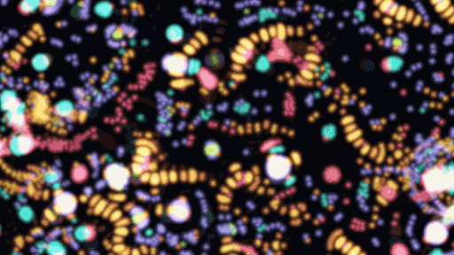
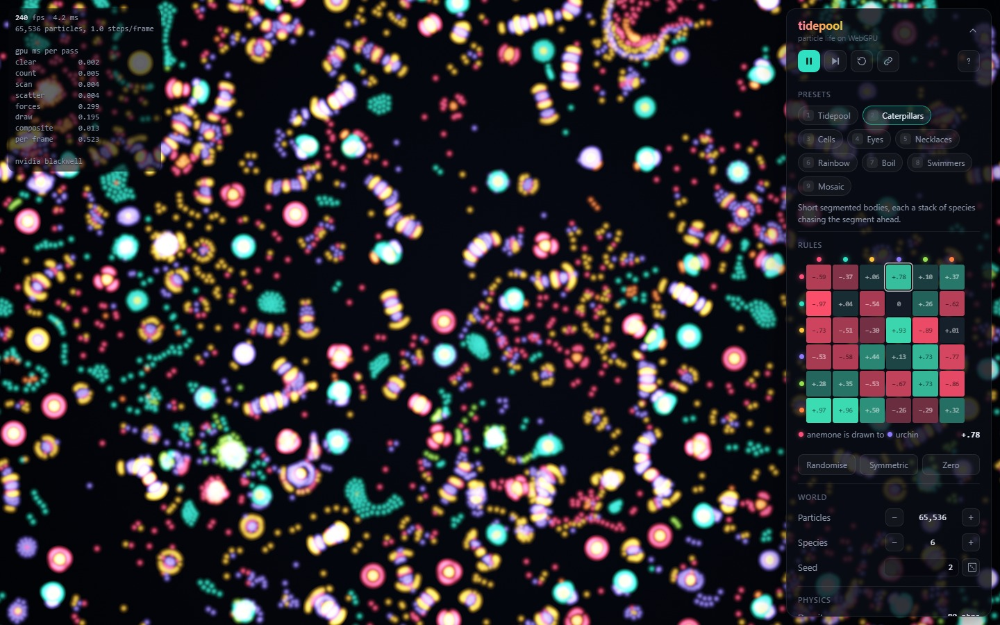
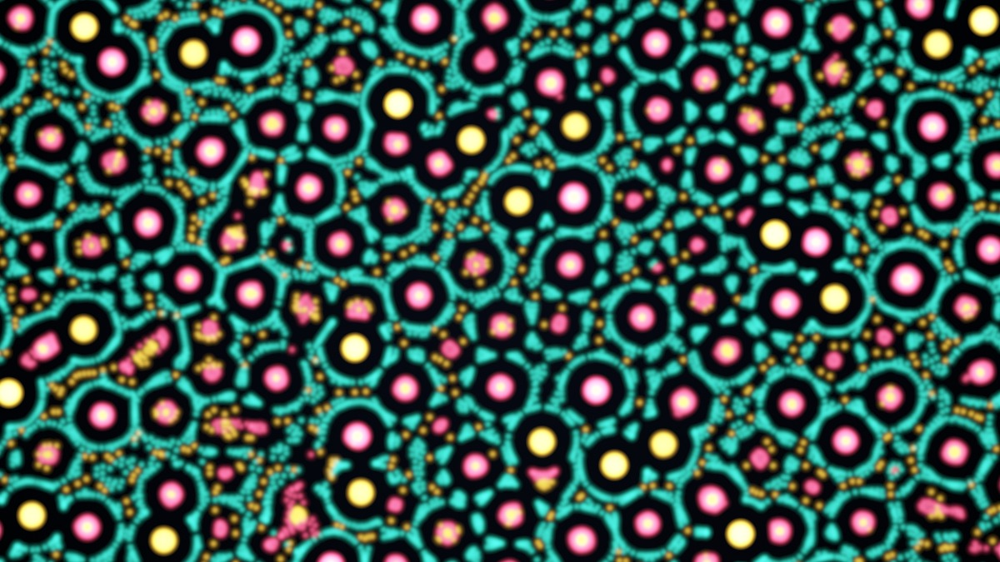
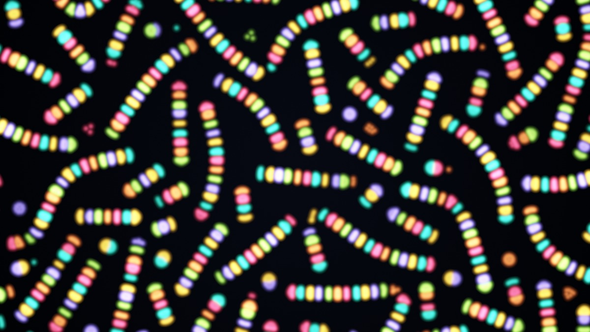
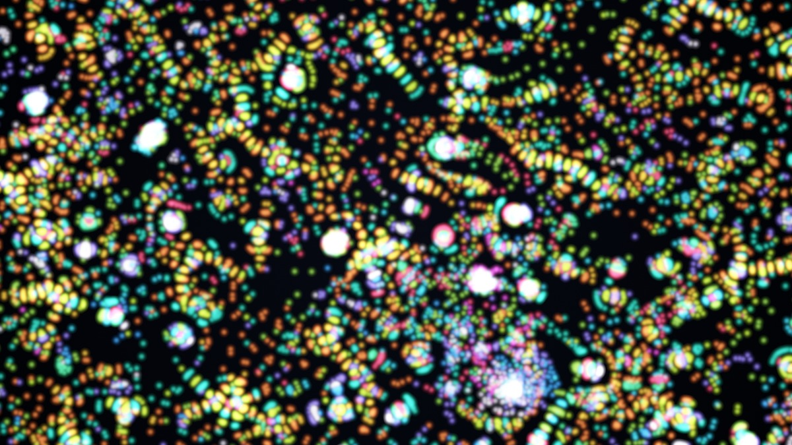

<p align="center">
  
</p>

<h1 align="center">tidepool</h1>

<p align="center">
  Particle life in the browser: up to a million particles following a handful of attraction rules, simulated entirely in WebGPU compute shaders.
</p>

<p align="center">
  <a href="https://autumntrace.github.io/tidepool/"><b>Open the live demo</b></a>
</p>

<p align="center">
  <a href="https://github.com/AutumnTrace/tidepool/actions/workflows/ci.yml"></a>
  <a href="https://github.com/AutumnTrace/tidepool/actions/workflows/pages.yml"></a>
  <a href="LICENSE"></a>
</p>

## What you're looking at

Every particle belongs to one of K species (2 to 12). A K x K matrix says how much species *i* is drawn to species *j*, from +1 (strongly attracted) to -1 (strongly repelled). Within an interaction radius, a particle feels a short-range push away from everything (so nothing collapses to a point) and then, a little further out, a triangular bump of attraction or repulsion scaled by that matrix entry. Beyond the radius, nothing. Add friction, wrap the edges around into a torus, step it forward 50 times a simulated second, and that's the whole model.

The interesting part is that the matrix doesn't have to be symmetric. If red chases blue but blue runs from red, momentum isn't conserved, energy leaks in, and you get things that look alive: worms that crawl, cells with membranes, rings that rotate, swarms that never settle. Symmetric matrices, on the other hand, have nothing to drive them and freeze into crystals. The presets below are what I found by rendering a few hundred random matrices as contact sheets and keeping the ones I could name.

## Controls

The panel on the right has everything; the keyboard has most of it.

| Key | Does | | Pointer | Does |
|---|---|---|---|---|
| <kbd>Space</kbd> | Play / pause | | Drag | Pull particles in (or push, with the Push tool) |
| <kbd>.</kbd> | Step once | | Right-drag | The opposite force |
| <kbd>R</kbd> | New random rules | | Middle-drag, Alt-drag | Pan around the torus |
| <kbd>N</kbd> | Respawn with a new seed | | Wheel, pinch | Zoom |
| <kbd>M</kbd> | Symmetric rules on / off | | Two fingers | Pan and zoom |
| <kbd>1</kbd> to <kbd>9</kbd> | Presets | | | |
| <kbd>[</kbd> <kbd>]</kbd> | Halve / double the particles | | | |
| <kbd>-</kbd> <kbd>=</kbd> | Fewer / more species | | | |
| <kbd>T</kbd> | Trails on / off | | | |
| <kbd>0</kbd> | Reset the camera | | | |
| <kbd>P</kbd> | Show / hide the panel | | | |
| <kbd>D</kbd> | GPU timings per pass | | | |
| <kbd>C</kbd> | Copy a link to this exact setup | | | |
| <kbd>F</kbd> | Fullscreen | | | |
| <kbd>?</kbd> | All of the above, in the app | | | |

The matrix editor is a heatmap: teal attracts, rose repels. Drag a cell up or down to change it (hold Shift for fine control), double-click to zero it, right-click to flip its sign. The arrow keys work on a focused cell too. Hovering a cell spells it out: "anemone is drawn to urchin, +.78".

Everything that defines what you see (seed, particle count, species, physics, the matrix itself, trails, glow and exposure) is kept in the URL hash, so any link reproduces the setup. The matrix is packed as one signed byte per entry in base64url, so even a 12-species matrix is only 192 characters of the link.

<p align="center">
  
</p>

## Presets

| | | |
|---|---|---|
| [](https://autumntrace.github.io/tidepool/#seed=3&k=3&m=F7fLv-W1MkMg) | [](https://autumntrace.github.io/tidepool/#seed=5&k=6&m=ZBScnJwUFGQUnJycnBRkFJycnJwUZBScnJycFGQUFJycnBRk) | [](https://autumntrace.github.io/tidepool/#seed=6&k=12&trails=0.6&m=9PLnRKa99ecATVJDUsux4qb7He0xwUinEfK-M-Jf6-m-xTfX1-AhzaGsFCdPKEPLHPMaDbIwDQUdAcs8xfJKyqW2IMBO0tisE7PyXTvtK1vlADbYosihDKLNWC3_WvT9PeMDJ1nnGU3OMeQoLLZKq5xfFTfnIV1k3CRU9EfU5MSdx9jo_vlfuWPaVcdZGg_A) |
| **Cells**: three species. Sea glass wraps the other two in membranes and the tissue tiles the whole world. | **Necklaces**: like yourself, tolerate your neighbours, hate everyone else. Symmetric, so it settles into beads and stays there. | **Rainbow**: all twelve species, a random matrix, trails on. Busy everywhere, forever. |

The other six are Tidepool (the default, in the GIF above), Caterpillars, Eyes, Boil, Swimmers and Mosaic. Click an image to open that preset live.

## How the GPU pipeline works

Each simulation step is five compute passes. Particles are re-sorted into a uniform grid every step with a counting sort, so the force pass only has to look at the 3 x 3 bins around each particle instead of at every other particle:

1. **clear** the per-bin counters.
2. **count**: each particle does an `atomicAdd` on its bin's counter. The value it gets back is its slot inside that bin, which it remembers.
3. **scan**: an exclusive prefix sum over the counters turns them into the first index of each bin. It's a multi-level scan (1024 elements per workgroup, block totals scanned recursively), so it handles any grid size; three levels cover a billion bins.
4. **scatter**: each particle copies itself to `binStart[bin] + slot`. No atomics needed, and no sorting network.
5. **forces + integrate**: walk the neighbouring bins, sum the kernel, apply friction, move, wrap. In a row-major grid the three bins of one row are a single contiguous run of the sorted buffer, so it's three loops rather than nine, and bins across the wrap seam are handled by shifting the particle into the neighbour's frame instead of wrapping every distance.

Then the renderer adds a glow sprite per particle into a half-float buffer and tone-maps it onto the canvas. [docs/how-it-works.md](docs/how-it-works.md) has the diagram, the buffer layouts and the details, and [docs/devlog.md](docs/devlog.md) has the things that went wrong on the way.

## Performance

Measured with `npm run bench` on one machine: Windows 11 Pro, NVIDIA GeForce RTX 5070 (Windows driver 32.0.16.2124), AMD Ryzen 7 9800X3D, Chrome 157.0.8103.79 driven headless by Playwright. Tidepool preset, 600 warm-up steps so the worms have formed, then 300 frames at exactly one simulation step per frame. GPU times are timestamp-query averages per pass; frame interval is `requestAnimationFrame` to `requestAnimationFrame`. Raw numbers are in [bench/results.json](bench/results.json).

| Particles | Sort (clear + count + scan + scatter) | Forces + integrate | Draw + tone-map | GPU per frame | Frame interval, mean / p95 |
|---:|---:|---:|---:|---:|---:|
| 16,384 | 0.010 ms | 0.27 ms | 0.18 ms | 0.46 ms | 4.17 / 4.30 ms |
| 65,536 | 0.016 ms | 0.41 ms | 0.19 ms | 0.61 ms | 4.17 / 4.30 ms |
| 262,144 | 0.033 ms | 0.82 ms | 0.39 ms | 1.24 ms | 4.17 / 4.30 ms |
| 1,048,576 | 0.11 ms | 3.54 ms | 1.43 ms | 5.08 ms | 5.23 / 8.40 ms |

Headless Chrome ran its frame clock at 240 Hz here, so 4.17 ms is the floor of that column: everything up to 262k particles is limited by the frame clock, not the GPU. A million particles runs at about 190 frames per second, or comfortably at 60 with a few steps per frame to spare.

Two things worth knowing about those numbers:

- **The sort is nearly free.** At a million particles, clearing, counting, scanning and scattering take 0.11 ms together. Almost all the time goes into the force pass, and that scales with how crowded the neighbourhoods are, not with the particle count as such.
- **The rules matter more than the count.** Same million particles, different presets: the force pass takes 0.99 ms for Necklaces (233 neighbour candidates visited per particle, about what a uniform spread gives) and 4.49 ms for Swimmers (693, because everything is packed into dense swimming clumps). See [bench/presets-1m.json](bench/presets-1m.json).

For scale, the brute-force O(N²) pass this replaced (still available with `?method=brute`) takes 1.60 ms at 16k particles, 11.0 ms at 65k and 148 ms at 262k on the same GPU.

## Correctness

The GPU code is checked against a float64 CPU reference that mirrors every pass (`src/sim/reference.ts`), itself checked against an O(N²) brute-force step in the unit tests. In the Playwright suite, on a real GPU:

- the GPU prefix sum is bit-exact against a CPU scan for lengths from 1 to 2.5 million (one, two and three levels);
- after one step of 4,096 particles, the bin offsets from count + scan match the CPU exactly;
- positions agree within 1e-5 interaction radii and velocities within 1e-4 after one step (measured: 1.9e-6, which is one f32 ulp at that world size, and 3.0e-6), and positions within 1e-4 after ten steps (measured: 4.3e-6);
- a URL hash survives a round trip through the running app, a reload, and a hand edit.

Particles are matched by id for these comparisons: the id rides along in the low bits of a packed `u32` (id << 4 | species), so the GPU can reorder particles every step without losing track of them.

## Browser support

tidepool needs WebGPU, and shows a short explanation instead of a blank page when it isn't there. Going by the [WebGPU implementation status page](https://github.com/gpuweb/gpuweb/wiki/Implementation-Status) (checked November 2026):

- **Chrome and Edge** on Windows, macOS and ChromeOS since 113; Android 12+ on most GPUs since 121; Linux on Intel Gen12+ since 144 and NVIDIA on Wayland since 147, other Linux setups behind a flag.
- **Safari 26** on macOS, iOS, iPadOS and visionOS.
- **Firefox** on Windows since 141, and on Apple Silicon Macs since 145 (macOS 26) or 147 (older macOS); Linux, Intel Macs and Android not yet in stable.

I've only run it myself on desktop Chrome on Windows with an NVIDIA card. Timings in the HUD need the `timestamp-query` feature; without it the HUD shows frame rate only. A million particles wants a discrete GPU; integrated graphics should start at the default 65k and work up.

## Running it locally

Node 24 and a WebGPU-capable Chrome.

```sh
npm install
npm run dev          # http://localhost:5173/tidepool/
npm test             # unit tests (Vitest)
npm run test:e2e     # Playwright against your installed Chrome; GPU tests skip without an adapter
npm run typecheck
npm run bench        # the performance table above, for your machine
npm run capture      # regenerates the GIF and screenshots in docs/media
```

There's no framework and no runtime dependency: Vite, TypeScript and WGSL. The app exposes `window.tidepool` for tests and curious people: `tidepool.app.state`, `tidepool.app.advance(100)`, `tidepool.gpuScan([1e6], 1)` and friends (see `src/debug.ts`).

## Known gaps and roadmap

- **Seeds reproduce the start, not the whole run.** The order of particles inside a bin depends on which `atomicAdd` wins, so floating-point sums happen in a different order each run and trajectories drift apart after a few hundred steps. A stable sort within bins would fix it at some cost.
- **Trails are screen-space.** They clear whenever the camera moves instead of being reprojected.
- **The force pass is a straightforward one-thread-per-particle loop.** Half-size cells with a 5 x 5 neighbourhood would cut the candidate area by about 30%, and the neighbour walk could be tiled through workgroup memory. Neither is done yet.
- **No subgroup operations.** The scan uses a workgroup-memory Hillis-Steele step where `subgroupExclusiveAdd` would do, on adapters that have it.
- **Only tested on one machine.** Numbers and behaviour on Safari, Firefox, mobile and integrated GPUs are unverified.
- **No auto-tuning.** It doesn't pick a particle count for your GPU; it starts at 65,536 and lets you double it.

## Credits and references

- Jeffrey Ventrella's [Clusters](https://www.ventrella.com/Clusters/), the asymmetric particle system this whole genre grows out of.
- Tom Mohr's [particle-life.com](https://particle-life.com/) and [particle-life-app](https://github.com/tom-mohr/particle-life-app); the force kernel and the half-life form of friction follow his formulation.
- Simon Green, [Particle Simulation using CUDA](https://developer.download.nvidia.com/assets/cuda/files/particles.pdf) (NVIDIA CUDA SDK whitepaper), for the uniform-grid neighbour search built by sorting.
- Mark Harris, Shubhabrata Sengupta and John D. Owens, [Parallel Prefix Sum (Scan) with CUDA](https://developer.nvidia.com/gpugems/gpugems3/part-vi-gpu-computing/chapter-39-parallel-prefix-sum-scan-cuda), GPU Gems 3, chapter 39, for the block-sums approach to large scans.
- Guy Blelloch, [Prefix Sums and Their Applications](https://www.cs.cmu.edu/~guyb/papers/Ble93.pdf).
- The [WebGPU](https://www.w3.org/TR/webgpu/) and [WGSL](https://www.w3.org/TR/WGSL/) specifications.
- [gifenc](https://github.com/mattdesl/gifenc) by Matt DesLauriers encodes the GIF at the top.

## License

[MIT](LICENSE), © 2026 Mina Rotari.
