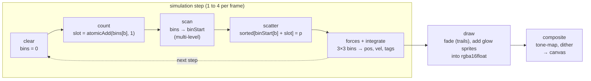

# How tidepool works

This is the long version of the README's pipeline section: what runs on the GPU each frame, what the buffers look like, and why a few things are done the way they are. File names are relative to `src/`.

## The model

Distances are measured in units of the interaction radius, so `R_MAX = 1`. For a particle of species *i* at distance *r* from a particle of species *j*, with attraction *a = A[i][j]* and repulsion radius *β* (0.3 by default):

```
            r / β - 1                               r < β       (always repulsive)
k(r, a) =   a * (1 - |2r - 1 - β| / (1 - β))        β ≤ r < 1   (triangle peaking at (1+β)/2)
            0                                       r ≥ 1
```

The kernel is continuous at β and at 1. The acceleration on a particle is `force * Σ k(r, a) * unit_vector`, plus the pointer's push or pull. Integration is semi-implicit Euler with a fixed `dt = 0.02 s`:

```
v ← v * 0.5^(dt / halfLife) + accel * dt
x ← wrap(x + v * dt)
```

`halfLife` is the friction slider: the time it takes for an unforced particle to lose half its speed. Writing friction that way (as Tom Mohr's particle-life app does) keeps it meaningful if `dt` ever changes.

The world is a square torus whose size grows with the particle count, `size = sqrt(N * π / density)`, where `density` is the mean number of neighbours inside the radius for a uniform spread. Doubling the particles doubles the area, so the local physics, and therefore what the presets look like, doesn't change with N.

## One frame



The frame loop (`app.ts`) runs a fixed-timestep accumulator: 60 steps per wall-clock second at speed 1, at most 4 per frame, and fewer if the measured GPU time per step says they won't fit in about 12 ms. When the GPU can't keep up the simulation slows down instead of the frame rate collapsing. All passes for a frame go into one command encoder and one `queue.submit`.

## Buffers

Particle state is structure-of-arrays. `N` is the particle count.

| Buffer | WGSL type | Bytes per particle | Written by | Read by |
|---|---|---:|---|---|
| `pos` | `array<vec2f>` | 8 | upload, forces | count, scatter, draw |
| `vel` | `array<vec2f>` | 8 | upload, forces | scatter |
| `tags` | `array<u32>` | 4 | upload, forces | scatter, draw |
| `rank` | `array<u32>` | 4 | count | scatter |
| `sortedPos` | `array<vec2f>` | 8 | scatter | forces |
| `sortedVel` | `array<vec2f>` | 8 | scatter | forces |
| `sortedTags` | `array<u32>` | 4 | scatter | forces |

That's 44 bytes per particle, 44 MiB at a million. A tag packs `(id << 4) | species`: four bits are enough for 12 species and the id lets tests match GPU output to the CPU reference even though particles are reordered every step.

The grid has `grid × grid` bins with `grid = floor(size / R_MAX)`, so a bin is never smaller than the interaction radius and a 3 × 3 block of bins always contains every possible neighbour. At a million particles and the default density that's 202 × 202 = 40,804 bins.

| Buffer | WGSL type | Size |
|---|---|---|
| `bins` (scan level 0) | `array<atomic<u32>>` in count, `array<vec4u>` in scan, `array<u32>` in scatter and forces | `bins + 1` u32, padded to a multiple of 1024 |
| scan level *k* | `array<vec4u>` | `ceil(previous / 1024)` u32, padded to a multiple of 1024 |

The extra bin at the end always counts zero, so after the exclusive scan it holds `N`. That means the end of bin `b` is always `binStart[b + 1]`, with no special case for the last bin.

The uniform block shared by all simulation passes (`shaders/common.wgsl`, packed by `gpu/params-buffer.ts`) is 640 bytes:

| Offset | Field | Notes |
|---:|---|---|
| 0 | `count, species, grid, bins` | `u32` × 4 |
| 16 | `worldSize, invCell, rMax, beta` | `f32` × 4 |
| 32 | `forceScale, friction, dt, pointerRadius` | friction is the per-step multiplier |
| 48 | `pointer: vec2f, pointerStrength, _pad` | strength > 0 pulls, < 0 pushes |
| 64 | `matrix: array<vec4f, 36>` | 12 × 12 floats, row = species being pushed |

## The passes

**clear** (`clear.wgsl`) zeroes the whole padded bin buffer, one `vec4u` per thread. It's a compute pass rather than `encoder.clearBuffer` only so it shows up in the timings; it costs about 2 µs.

**count** (`count.wgsl`) computes each particle's bin and does `atomicAdd(&bins[b], 1)`. The return value (the count before this particle) is the particle's slot within its bin, and goes into `rank`. Because of that, the scatter pass doesn't need atomics of its own. The bin index is clamped with `min(..., grid - 1)` because `floor()` on a coordinate a hair under `worldSize` can round up to `worldSize` itself in f32.

**scan** (`scan.wgsl`, `gpu/prefix-sum.ts`) turns counts into start offsets. One workgroup of 256 threads handles a block of 1024 values: each thread loads one `vec4u` (coalesced 16-byte loads), scans its four values serially, writes its total to workgroup memory, and an 8-round Hillis-Steele scan over the 256 totals gives each thread its offset. The block total goes to the next level's buffer. Levels repeat until one block is enough, then `addSums` dispatches walk back down adding each block's scanned offset. All of it is one compute pass: WebGPU inserts the storage barriers between dispatches. Values past the real length are masked to zero, so padding never needs clearing.

**scatter** (`scatter.wgsl`) writes particle `i` to `binStart[bin(i)] + rank[i]` in the three sorted buffers. It recomputes the bin from the position rather than storing it; the arithmetic is identical to the count pass so it always agrees.

**forces** (`forces.wgsl`) runs one thread per sorted particle, 128 per workgroup:

- The workgroup first copies the 144-float matrix from the uniform buffer into workgroup memory. Neighbouring threads look up different columns, and divergent indexing into a uniform array serialises; this alone took the pass from 4.5 ms to 3.75 ms at a million particles.
- For each of the three rows of bins around the particle, if the particle's bin isn't on the left or right edge, the three bins in that row are one contiguous range `[binStart[row + x - 1], binStart[row + x + 2])`. Otherwise it falls back to three separate ranges with wrapping.
- When a row or column wraps around the torus, the particle's position is shifted by ±`worldSize` for that range (`local = p - shift`), so the inner loop is plain `d = q - local` with no per-neighbour wrapping.
- The inner loop uses `inverseSqrt(r²)` once and derives both `r` and `1/r` from it.
- The result is written back to `pos`, `vel` and `tags` at the sorted index, so the primary buffers end every step sorted by bin. That's free locality for the next step's count and scatter.

## Rendering

`gpu/renderer.ts` does two render passes.

**draw** targets an `rgba16float` texture the size of the canvas. With trails on and the camera still, it first draws a full-screen triangle whose blend state is `dst * constant`, with the blend constant set to the trail persistence, which fades the previous frame in place without a second texture. Then it draws `4` vertices × `N × copies` instances as additive sprites: a tight Gaussian core plus a faint wide halo. Half floats matter here: hundreds of overlapping sprites can add up far past 1.0, and a slow fade in 8 bits leaves permanent faint smears where the rounding stops making progress.

Sprites have a fixed size in world units, but their radius never drops below 2.2 device pixels; past that point they stop shrinking and get dimmer by the area they lost, so a zoomed-out million particles reads as a density field instead of shimmering.

Because the world is a torus, one particle can be on screen more than once. The visible span plus a sprite radius of margin can hold at most `copiesX × copiesY` images of any particle (2 × 1 in the default 16:9 view, more when zoomed out). Instance `i` draws particle `i % N`, image `i / N`, starting from the first image at or after the left and top edges of the span. Images that still fall off screen are collapsed to a point outside the clip volume in the vertex shader.

**composite** reads the HDR texture with `textureLoad`, adds a very faint blue vignette, applies `1 - exp(-x * exposure)` per channel, converts to sRGB, and adds half an 8-bit step of hash noise to hide banding in the dark gradients. Per-channel tone mapping is what makes dense clusters bloom to white while lone particles keep their colour.

## URL state

`sim/url-state.ts` encodes the whole configuration as a readable hash:

```
#seed=3&n=65536&k=3&density=80&force=10&friction=0.04&beta=0.3&speed=1&trails=0&glow=1&exposure=1&m=F7fLv-W1MkMg
```

Matrix values live on a 0.01 grid everywhere in the app, so `m` (one signed byte per entry, base64url) decodes to exactly the same numbers. Decoding never throws: unknown keys are ignored, numbers are clamped and snapped to the slider steps, and a missing or wrong-sized matrix is generated from the seed. The app rewrites the hash with `history.replaceState` (debounced) as you play, and listens for `hashchange` so pasting a link into an open tab works.

## Testing the GPU

`sim/reference.ts` implements count, scan, scatter, forces and integration on the CPU in float64, with `Math.fround` wherever the shader receives an f32 constant or computes a bin index, so the CPU puts every particle in the same bin the GPU does. The Vitest suite checks it against an O(N²) step; the Playwright suite (`e2e/simulation.spec.ts`) checks the GPU against it. Both sides sum forces in different orders (the GPU's order inside a bin depends on atomics), so positions are compared with a tolerance, matched up by the id in each particle's tag.

`window.tidepool` (`debug.ts`) is how the tests and scripts reach in: `gpuStep` builds a throwaway `Simulation` on the app's device, `gpuScan` runs the prefix sum on random input, `bench` runs the timing loop behind the README table, and `captureFrame` reads a frame back in the same task that rendered it (after that task ends the canvas texture has been presented and can't be read).
